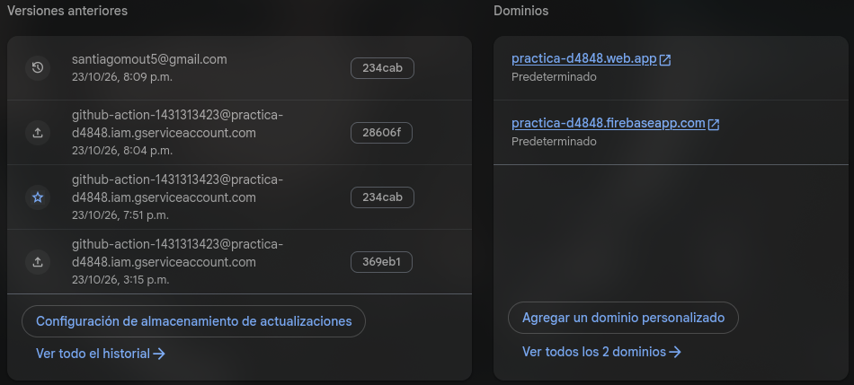
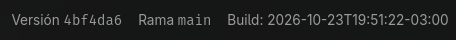

# Reflexión · Práctica CI/CD con Firebase Hosting

Respuestas breves y concretas a las preguntas de la sección 8 del enunciado.

---

## 1. ¿Por qué el preview tiene vencimiento? ¿Qué riesgos tendría un preview que no vence nunca?

El preview tiene vencimiento (`expires: 3d`) porque es un entorno efímero para revisar un Pull Request, no un entorno permanente. Si no vence nunca, se acumularían canales olvidados, se consumiría cuota de Hosting sin necesidad, y quedaría contenido desactualizado o expuesto públicamente sin control, aumentando la superficie de ataque con versiones antiguas de la app.

## 2. ¿Qué diferencia hay entre desplegar y liberar? ¿Dónde aparece cada concepto en este flujo?

**Desplegar** es subir una versión a un entorno (preview o live). **Liberar** es poner esa versión a disposición de los usuarios finales. En este flujo, el workflow despliega automáticamente al canal `live` al mergear a `main`, pero la liberación real ocurre cuando los usuarios acceden a `https://prueba-6cd12.web.app/`. El rollback de Firebase revierte lo desplegado sin tocar el código de `main`.

Como `main` conserva el código nuevo, el próximo merge volverá a desplegar esa versión. En un equipo real se resuelve con un **revert** (commit que deshace los cambios en `main`) o un hotfix, no confiando solo en el rollback de Hosting.

## 3. ¿Por qué la clave de la service account va en un secreto y no en el repo? ¿Qué podría hacer alguien que la obtenga? ¿Cómo limitarías el daño?

Para no exponer credenciales en el historial de Git. Quien la obtenga podría desplegar versiones maliciosas o borrar releases en el proyecto de Firebase. Se limita el daño usando una service account con el mínimo permiso necesario (solo Hosting), rotando la clave periódicamente, y revisando los accesos en la consola de Firebase.

## 4. La CSP rompió la app: ¿por qué? ¿Qué opciones evaluaste y qué costo de seguridad tiene cada una?

La exportación estática de Next.js genera scripts en línea (`<script>...</script>` sin `src`) en el HTML. Con `script-src 'self'` esos scripts quedan bloqueados porque `'self'` solo permite scripts externos del mismo origen.

Opciones evaluadas:

- `'unsafe-inline'`: funciona, pero autoriza cualquier script inyectado (XSS). Menos seguro, se descarta.
- `nonce-`: en Firebase Hosting los headers son estáticos, así el nonce sería público y no aporta seguridad real. Además Next.js no puede inyectar un nonce por-request en HTML prerenderizado.
- Hashes `sha256-`: se permiten solo los 8 scripts en línea exactos. Es mínimo privilegio, pero los hashes están atados al output del build: cada `next build` puede cambiarlos, obligando a recalcularlos y actualizar `firebase.json` antes de desplegar.

## 5. Para cada header de B2, ¿qué ataque mitiga?

| Header                    | Valor                                      | Qué hace                                                        | Ataque que mitiga                                                                 |
| ------------------------- | ------------------------------------------ | --------------------------------------------------------------- | --------------------------------------------------------------------------------- |
| Strict-Transport-Security | `max-age=31536000; includeSubDomains`      | Fuerza HTTPS durante 1 año, también en subdominios.             | SSL stripping / downgrade MITM: obliga a HTTPS en visitas futuras.                |
| X-Content-Type-Options    | `nosniff`                                  | Prohíbe que el navegador adivine el tipo de archivo.            | XSS por contenido subido: evita que un archivo malicioso se ejecute como HTML/JS. |
| X-Frame-Options           | `DENY`                                     | Impide embeber el sitio en un iframe de ningún origen.          | Clickjacking: evita clics no deseados ocultando la página en un iframe.           |
| Referrer-Policy           | `strict-origin-when-cross-origin`          | Hacia otros sitios envía solo el origen, no ruta ni parámetros. | Filtración de datos vía Referer: no expone URLs internas ni tokens.               |
| Permissions-Policy        | `camera=(), microphone=(), geolocation=()` | Deshabilita cámara, micrófono y geolocalización.                | Espionaje sensorial / rastreo: bloquea sensores aunque un script lo solicite.     |

## 6. ¿Por qué los assets de `/_next/static/` pueden cachearse un año y el HTML no?

Los assets de `/_next/static/` tienen nombres con hash de contenido (son inmutables), así que pueden cachearse por un año con `immutable`: si cambian, cambia la URL y el navegador descarga la nueva versión. El HTML no lleva hash y se reescribe en cada deploy; si se cacheara sin revalidar, un deploy o un rollback tardaría en verse por los usuarios.

## 7. Si la app necesitara SSR, ¿qué cambiaría en la arquitectura, en la CSP y en el costo?

Cambiaría de Firebase Hosting (estático, plan Spark, costo cero) a Firebase App Hosting sobre Cloud Run, que requiere el plan Blaze con cuenta de facturación (costo mayor). En la arquitectura se pasaría de export estático a SSR con Server Actions o Route Handlers. En la CSP, al poder inyectar valores por-request, se podría usar `nonce-` en lugar de hashes estáticos, y no dependería de recalcular hashes en cada build.

---

## Decisión de seguridad: Content-Security-Policy

La exportación estática de Next.js genera 8 scripts en línea en `cursos.html` (bootstrap de Turbopack y datos de vuelo RSC). Con `script-src 'self'` el navegador los bloquea porque `'self'` solo cubre scripts externos del mismo origen.

Se usaron **hashes `sha256-` explícitos** (uno por script) junto a `'self'` para scripts externos: es el mínimo privilegio, solo esos 8 cuerpos exactos se ejecutan.

- `'unsafe-inline'` se descarta: autoriza cualquier script inyectado (XSS).
- `nonce-` no aporta seguridad real aquí: en Firebase Hosting los headers son estáticos, así el nonce sería público, y Next.js no puede inyectar uno por-request en HTML prerenderizado.

**Costo operativo:** los hashes están atados a la salida de `next build`; un rebuild puede cambiarlos, obligando a recalcularlos y actualizar `firebase.json` antes de desplegar.

**`img-src`:** además de `'self'`, se permite `https://picsum.photos` (origen de la portada, verificado en Network). No se agregó `data:` ni `blob:` porque la app no los usa.

## Verificación

```bash
npm run build && npm run serve
node scripts/check-headers.mjs http://localhost:5000
```

Los 5 headers aparecen presentes en `/`, `/cursos`, el 404 y los assets estáticos.

---

## Evidencia de los entregables

| Entregable         | Valor                                                                                                                     |
| ------------------ | ------------------------------------------------------------------------------------------------------------------------- |
| URL al repocitorio | `https://github.com/MoutSantiago/practica_cicd`                                                                           |
| Link a PR mergeado | `https://github.com/MoutSantiago/practica_cicd/pull/7` (incluye el comentario del bot de Firebase con la URL del preview) |
| URL de producción  | `https://prueba-6cd12.web.app/`                                                                                           |
| Nombre del secreto | `FIREBASE_SERVICE_ACCOUNT_PRUEBA_6CD12`                                                                                   |
| Project ID         | `prueba-6cd12`                                                                                                            |

### Salida de `check-headers.mjs` **antes**

```
  ▶ HTML: https://prueba-6cd12.web.app/
    status 200
    ✘ content-security-policy (falta)
    ✔ strict-transport-security: max-age=31556926; includeSubDomains; preload
    ✘ x-content-type-options (falta)
    ✘ x-frame-options (falta)
    ✘ referrer-policy (falta)
    ✘ permissions-policy (falta)
    · cache-control: max-age=3600

  ▶ Asset estático: /_next/static/chunks/1x6obpmlu1_c2.js
    ✘ cache-control: max-age=3600

  ❌ 6 control(es) pendiente(s).
```

### Salida de `check-headers.mjs` **después**

```
  ▶ HTML: https://prueba-6cd12.web.app/
    status 200
    ✔ content-security-policy: default-src 'self'; script-src 'self' sha256-ohBYDP4jDEhpM4V4o0iLmc/txsVyq1JPbtSx6ah7HBw= sha256-OBTN3RiyCV4Bq…
    ✔ strict-transport-security: max-age=31556926; includeSubDomains; preload
    ✔ x-content-type-options: nosniff
    ✔ x-frame-options: DENY
    ✔ referrer-policy: strict-origin-when-cross-origin
    ✔ permissions-policy: camera=(), microphone=(), geolocation=()
    · cache-control: no-cache, must-revalidate

  ▶ Asset estático: /_next/static/chunks/1x6obpmlu1_c2.js
    ✔ cache-control: public, max-age=31536000, immutable

  ✅ Todos los controles pasaron.
```

### Resultado de rollback en firebase



**Footer de la ui:**


---

## Reflexión · Clase 2 · SQL Connect

---

### 1. ¿Por qué ninguna operación de este conector recibe el `id` del alumno como variable? ¿Qué es IDOR y cómo lo evita `auth.uid`?

Ninguna operación recibe el `id` del alumno como variable porque el cliente es público y no es de confianza. Si el cliente pudiera enviar un `alumnoId`, un atacante podría leer o modificar inscripciones de otros usuarios simplemente adivinando o suplantando ese ID.

**IDOR** (_Insecure Direct Object Reference_) es una vulnerabilidad donde el cliente referencia directamente un objeto interno (como un ID de usuario o de inscripción) sin que el servidor verifique si el usuario autenticado tiene permiso sobre él.

Se evita con `auth.uid`: el servidor toma el UID del token de Firebase Auth (que no puede ser falsificado por el cliente) y lo usa como clave para buscar o escribir datos, nunca confiando en lo que el cliente envía.

---

### 2. `ListCursos` es `PUBLIC` y `ListAlumnos` terminó en `NO_ACCESS`. ¿Qué criterio usaste? ¿Cómo haría el "panel de admin" para listar alumnos?

El criterio es **mínimo privilegio basado en la sensibilidad de los datos**:

- `ListCursos` → `PUBLIC`: el catálogo de cursos es información pública, cualquiera puede verlo.
- `ListAlumnos` → `NO_ACCESS`: devuelve datos personales (nombre, email) de todos los alumnos. No debe estar expuesta al cliente bajo ninguna circunstancia.

Para un "panel de admin", `ListAlumnos` se ejecutaría desde una herramienta de administración con privilegios de servicio (Firebase Console, Cloud Functions, o un script con credenciales de admin), no desde el cliente del navegador. Nunca con `@auth(level: PUBLIC)`.

---

### 3. ¿Qué ventaja tiene una clave primaria compuesta en `Matricula` frente a validar duplicados en el código del cliente?

La clave compuesta `["alumno", "curso"]` garantiza en la **base de datos** que un alumno no pueda inscribirse dos veces al mismo curso, independientemente de cuántos clientes o solicitudes concurrentes haya. Es una restricción a nivel de esquema, no de aplicación.

Validar duplicados solo en el cliente es frágil: se puede saltar con un script directo a la API, con condiciones de carrera (dos peticiones simultáneas), o si el cliente está comprometido. La base de datos es la última línea de defensa.

---

### 4. La configuración de Firebase (`apiKey`, etc.) es pública. ¿Por qué eso no compromete la base de datos? ¿Qué capa faltaría para frenar a alguien que usa esa config desde un script?

La configuración (`apiKey`, `authDomain`, `projectId`, `appId`) identifica el proyecto, pero **no autentica** ni autoriza por sí sola. La seguridad recae en:

- **Firebase Auth**: solo usuarios con token válido pueden ejecutar operaciones `@auth(level: USER)`.
- **SQL Connect `@auth`**: cada operación declara quién puede ejecutarla, y el servidor rechaza peticiones no autorizadas antes de tocar la base de datos.

La capa que faltaría para frenar a alguien que usa esa config desde un script es **App Check**. App Check verifica que la petición proviene de tu app legítima (no de un script aleatorio con la config pública), bloqueando clientes no autorizados antes de que lleguen a SQL Connect.

---

### 5. Comparado con una API REST propia (Express + pg), ¿qué te da SQL Connect y qué perdés?

**Te da:**

- Seguridad por defecto: `@auth` declara quién ejecuta cada operación, sin escribir middleware de autorización disperso.
- No hay endpoint de SQL arbitrario: el cliente solo invoca operaciones con nombre, cerrado a inyección SQL por diseño.
- Menos código de backend: no tenés que escribir rutas, controladores, ni manejar conexión a PostgreSQL manualmente.
- Emuladores integrados para desarrollo local.

**Perdés:**

- Flexibilidad total: no podés escribir consultas SQL arbitrarias ni lógica de negocio compleja en el servidor (no hay controlador personalizado por operación).
- Control fino sobre el esquema SQL generado: SQL Connect lo compila automáticamente.
- Dependés del ecosistema Firebase; migrar a otro proveedor requiere reescribir la capa de acceso.

---

### 6. ¿Por qué no alcanzó con la CSP de la clase 1 y por qué conviene listar dominios exactos en `connect-src`?

La CSP de la clase 1 tenía `connect-src 'self'`, que solo permite llamadas al mismo origen. En la clase 2 la app necesita hablar con Firebase Auth y SQL Connect, que están en otros dominios (`googleapis.com`). Sin `connect-src` con esos orígenes, el navegador bloquea las peticiones con `Refused to connect`.

Conviene listar **dominios exactos** (no comodines como `https://*.googleapis.com`) por principio de mínimo privilegio: si un atacante logra inyectar código, solo puede llamar a los dominios que necesitás, no a cualquier subdominio de Google. Reduce la superficie de ataque.

---

## Evidencia pendiente de completar

Reemplazá los placeholders abajo con la información real de tus entregables:

| Entregable                                                           | Valor                                                                               |
| -------------------------------------------------------------------- | ----------------------------------------------------------------------------------- |
| Salida de `npm run atacar` **antes** (con `ListAlumnos` como `vuln`) | Pegá acá la salida del emulador antes de corregir L4                                |
| Salida de `npm run atacar` **después** (sin vulnerabilidades)        | Pegá acá la salida del emulador después de corregir L4                              |
| URL de producción                                                    | `https://prueba-6cd12.web.app/`                                                     |
| Link al repo                                                         | `https://github.com/MoutSantiago/practica_cicd`                                     |
| Link a PR mergeado con CSP (L6)                                      | URL del PR que mergeaste a `main` con el cambio de `firebase.json`                  |
| Producción con inscripción funcionando                               | Verificá que se pueda crear cuenta e inscribirse en `https://prueba-6cd12.web.app/` |

### Salida de `npm run atacar` antes de L4

```
npm notice run practica-firebase-cicd@1.0.0 atacar
npm notice run node scripts/atacar.mjs

Auditoría de SQL Connect · proyecto practica-d4848 · emuladores locales

✔️ ListCursos responde sin login (7 cursos) — público por diseño
✘ ListAlumnos devuelve datos personales SIN login
    Ejemplo filtrado: {"email":"ana@ejemplo.test","id":"seed-uid-ana","nombre":"Ana Ficticia"}
[2026-11-02T04:16:01.261Z]  @firebase/data-connect: DataConnect (13.1.0): Error while performing request: {"code":16,"message":"unauthenticated: this operation requires a signed-in user","details":[{"@type":"type.googleapis.com/google.firebase.dataconnect.http.GraphqlError","message":"@auth rejected the request","locations":[],"path":null,"extensions":{"file":"","code":"UNAUTHENTICATED","debugDetails":"@auth(level: USER) requires a signed-in user","resource":"","warningLevel":"WARNING_LEVEL_UNKNOWN","workarounds":[]}}]}
✔️ Inscribirme rechazada sin login
    unauthenticated: this operation requires a signed-in user
✔️ Inscribirme es idempotente (repetir no falla)
✔️ MisInscripciones solo devuelve lo del usuario que llama
[2026-11-02T04:16:01.922Z]  @firebase/data-connect: DataConnect (13.1.0): Error while performing request: {"code":5,"message":"operation \"DarmeDeBaja\" not found","details":[]}
… DarmeDeBaja todavía no existe (TODO L5, opcional)

❌ 1 vulnerabilidad(es) · 1 pendiente(s)
```

### Salida de `npm run atacar` despues de L4

```
npm notice run practica-firebase-cicd@1.0.0 atacar
npm notice run node scripts/atacar.mjs

Auditoría de SQL Connect · proyecto practica-d4848 · emuladores locales

✔️ ListCursos responde sin login (7 cursos) — público por diseño
[2026-11-02T04:25:28.243Z]  @firebase/data-connect: DataConnect (13.1.0): Error while performing request: {"code":7,"message":"unauthorized: you are not authorized to perform this operation","details":[{"@type":"type.googleapis.com/google.firebase.dataconnect.http.GraphqlError","message":"@auth rejected the request","locations":[],"path":null,"extensions":{"file":"","code":"PERMISSION_DENIED","debugDetails":"@auth(level: NO_ACCESS) always reject non-admin requests","resource":"","warningLevel":"WARNING_LEVEL_UNKNOWN","workarounds":[]}}]}
✔️ ListAlumnos rechazada para un cliente
    unauthorized: you are not authorized to perform this operation
[2026-11-02T04:25:28.248Z]  @firebase/data-connect: DataConnect (13.1.0): Error while performing request: {"code":16,"message":"unauthenticated: this operation requires a signed-in user","details":[{"@type":"type.googleapis.com/google.firebase.dataconnect.http.GraphqlError","message":"@auth rejected the request","locations":[],"path":null,"extensions":{"file":"","code":"UNAUTHENTICATED","debugDetails":"@auth(level: USER) requires a signed-in user","resource":"","warningLevel":"WARNING_LEVEL_UNKNOWN","workarounds":[]}}]}
✔️ Inscribirme rechazada sin login
    unauthenticated: this operation requires a signed-in user
✔️ Inscribirme es idempotente (repetir no falla)
✔️ MisInscripciones solo devuelve lo del usuario que llama
[2026-11-02T04:25:28.912Z]  @firebase/data-connect: DataConnect (13.1.0): Error while performing request: {"code":5,"message":"operation \"DarmeDeBaja\" not found","details":[]}
… DarmeDeBaja todavía no existe (TODO L5, opcional)

… Sin vulnerabilidades detectadas, 1 control(es) pendiente(s)
```
