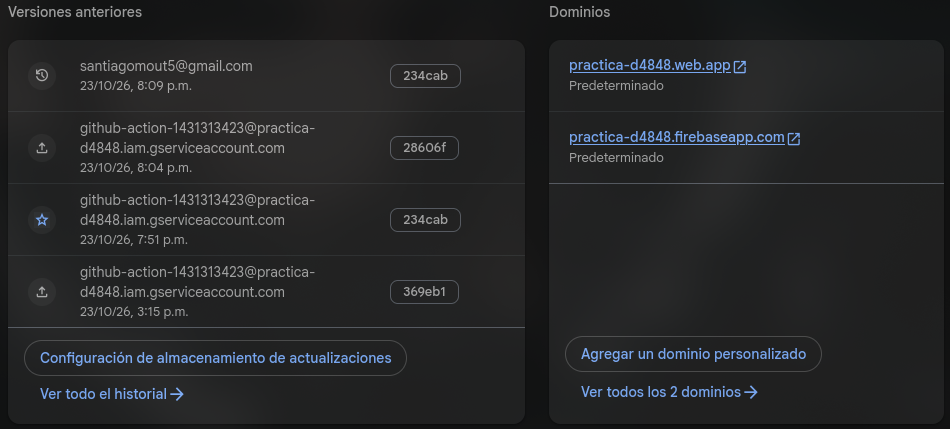
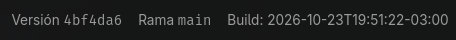

# Reflexión · Práctica CI/CD con Firebase Hosting

Respuestas breves y concretas a las preguntas de la sección 8 del enunciado.

---

## 1. ¿Por qué el preview tiene vencimiento? ¿Qué riesgos tendría un preview que no vence nunca?

El preview tiene vencimiento (`expires: 3d`) porque es un entorno efímero para revisar un Pull Request, no un entorno permanente. Si no vence nunca, se acumularían canales olvidados, se consumiría cuota de Hosting sin necesidad, y quedaría contenido desactualizado o expuesto públicamente sin control, aumentando la superficie de ataque con versiones antiguas de la app.

## 2. ¿Qué diferencia hay entre desplegar y liberar? ¿Dónde aparece cada concepto en este flujo?

**Desplegar** es subir una versión a un entorno (preview o live). **Liberar** es poner esa versión a disposición de los usuarios finales. En este flujo, el workflow despliega automáticamente al canal `live` al mergear a `main`, pero la liberación real ocurre cuando los usuarios acceden a `https://<PROJECT_ID>.web.app/`. El rollback de Firebase revierte lo desplegado sin tocar el código de `main`.

Como `main` conserva el código nuevo, el próximo merge volverá a desplegar esa versión. En un equipo real se resuelve con un **revert** (commit que deshace los cambios en `main`) o un hotfix, no confiando solo en el rollback de Hosting.

## 3. ¿Por qué la clave de la service account va en un secreto y no en el repo? ¿Qué podría hacer alguien que la obtenga? ¿Cómo limitarías el daño?

Para no exponer credenciales en el historial de Git. Quien la obtenga podría desplegar versiones maliciosas o borrar releases en el proyecto de Firebase. Se limita el daño usando una service account con el mínimo permiso necesario (solo Hosting), rotando la clave periódicamente, y revisando los accesos en la consola de Firebase.

## 4. La CSP rompió la app: ¿por qué? ¿Qué opciones evaluaste y qué costo de seguridad tiene cada una?

La exportación estática de Next.js genera scripts en línea (`<script>...</script>` sin `src`) en el HTML. Con `script-src 'self'` esos scripts quedan bloqueados porque `'self'` solo permite scripts externos del mismo origen.

Opciones evaluadas:

- `'unsafe-inline'`: funciona, pero autoriza cualquier script inyectado (XSS). Menos seguro, se descarta.
- `nonce-`: en Firebase Hosting los headers son estáticos, así el nonce sería público y no aporta seguridad real. Además Next.js no puede inyectar un nonce por-request en HTML prerenderizado.
- Hashes `sha256-`: se permiten solo los 8 scripts en línea exactos. Es mínimo privilegio, pero los hashes están atados al output del build: cada `next build` puede cambiarlos, obligando a recalcularlos y actualizar `firebase.json` antes de desplegar.

## 5. Para cada header de B2, ¿qué ataque mitiga?

| Header                                           | Ataque que mitiga                                                             |
| ------------------------------------------------ | ----------------------------------------------------------------------------- |
| Strict-Transport-Security                        | SSL stripping / downgrade MITM: obliga a HTTPS en visitas futuras.            |
| X-Content-Type-Options: nosniff                  | XSS por contenido subido: evita que el navegador adivine el tipo de archivo.  |
| X-Frame-Options: DENY                            | Clickjacking: impide embeber el sitio en un iframe.                           |
| Referrer-Policy: strict-origin-when-cross-origin | Filtración de datos vía Referer: no expone rutas ni tokens a sitios externos. |
| Permissions-Policy                               | Espionaje sensorial: deshabilita cámara, micrófono y geolocalización.         |

## 6. ¿Por qué los assets de `/_next/static/` pueden cachearse un año y el HTML no?

Los assets de `/_next/static/` tienen nombres con hash de contenido (son inmutables), así que pueden cachearse por un año con `immutable`: si cambian, cambia la URL y el navegador descarga la nueva versión. El HTML no lleva hash y se reescribe en cada deploy; si se cacheara sin revalidar, un deploy o un rollback tardaría en verse por los usuarios.

## 7. Si la app necesitara SSR, ¿qué cambiaría en la arquitectura, en la CSP y en el costo?

Cambiaría de Firebase Hosting (estático, plan Spark, costo cero) a Firebase App Hosting sobre Cloud Run, que requiere el plan Blaze con cuenta de facturación (costo mayor). En la arquitectura se pasaría de export estático a SSR con Server Actions o Route Handlers. En la CSP, al poder inyectar valores por-request, se podría usar `nonce-` en lugar de hashes estáticos, y no dependería de recalcular hashes en cada build.

---

## Evidencia de los entregables

| Entregable         | Valor                                                  |
| ------------------ | ------------------------------------------------------ |
| URL al repocitorio | `https://github.com/MoutSantiago/practica_cicd`        |
| Link a PR mergeado | `https://github.com/MoutSantiago/practica_cicd/pull/7` (incluye el comentario del bot de Firebase con la URL del preview) |
| URL de producción  | `https://practica-d4848.web.app/`                      |
| Nombre del secreto | `FIREBASE_SERVICE_ACCOUNT_PRACTICA_D4848`              |
| Project ID         | `practica-d4848`                                       |

### Salida de `check-headers.mjs` **antes**

```
  ▶ HTML: https://practica-d4848.web.app/
    status 200
    ✘ content-security-policy (falta)
    ✔ strict-transport-security: max-age=31556926; includeSubDomains; preload
    ✘ x-content-type-options (falta)
    ✘ x-frame-options (falta)
    ✘ referrer-policy (falta)
    ✘ permissions-policy (falta)
    · cache-control: max-age=3600

  ▶ Asset estático: /_next/static/chunks/1x6obpmlu1_c2.js
    ✘ cache-control: max-age=3600

  ❌ 6 control(es) pendiente(s).
```

### Salida de `check-headers.mjs` **después**

```
  ▶ HTML: https://practica-d4848.web.app/
    status 200
    ✔ content-security-policy: default-src 'self'; script-src 'self' sha256-ohBYDP4jDEhpM4V4o0iLmc/txsVyq1JPbtSx6ah7HBw= sha256-OBTN3RiyCV4Bq…
    ✔ strict-transport-security: max-age=31556926; includeSubDomains; preload
    ✔ x-content-type-options: nosniff
    ✔ x-frame-options: DENY
    ✔ referrer-policy: strict-origin-when-cross-origin
    ✔ permissions-policy: camera=(), microphone=(), geolocation=()
    · cache-control: no-cache, must-revalidate

  ▶ Asset estático: /_next/static/chunks/1x6obpmlu1_c2.js
    ✔ cache-control: public, max-age=31536000, immutable

  ✅ Todos los controles pasaron.
```

### Resultado de rollback en firebase



**Footer de la ui:**

